# Flow Diagrams - Zi.CARE POS

## 1. Overall System Flow

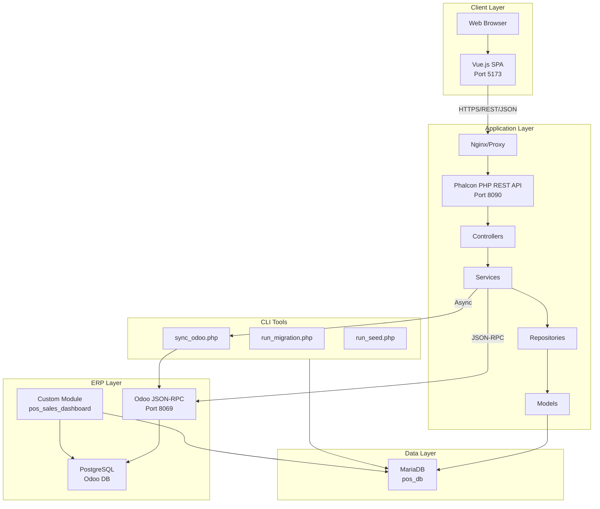

---

## 2. Authentication Flow

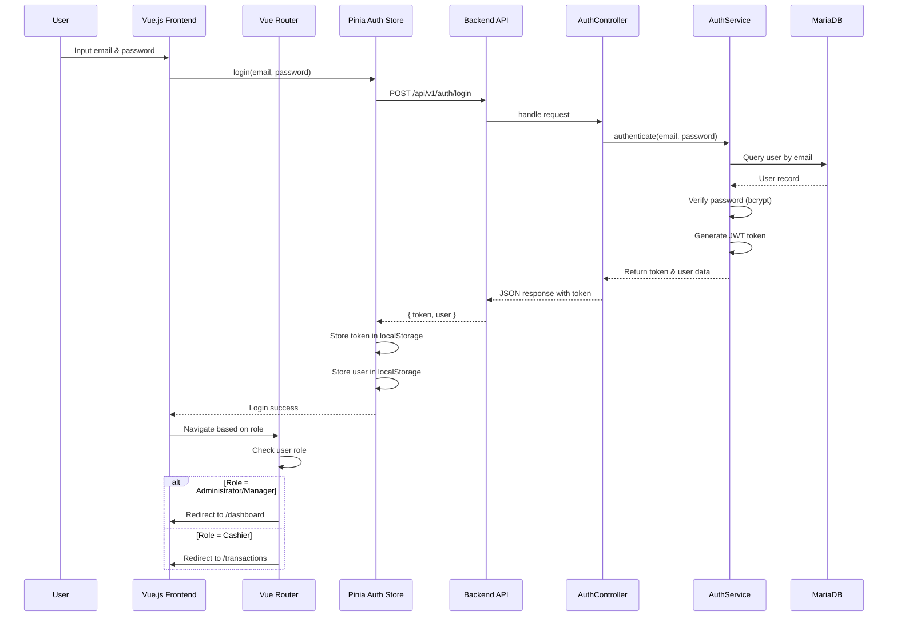

---

## 3. Transaction Flow

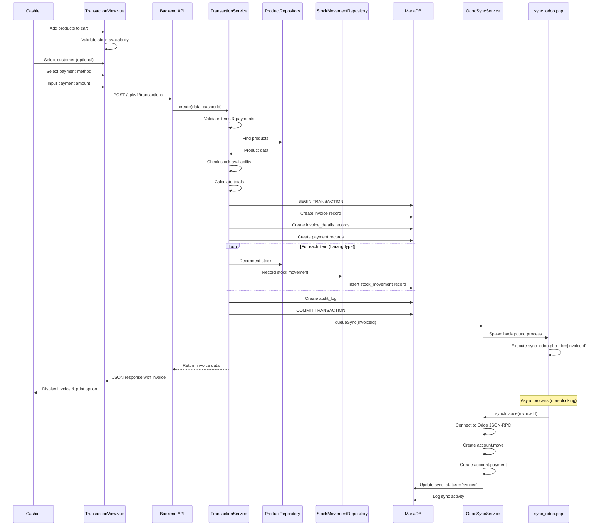

---

## 4. Odoo Sync Flow

```mermaid
flowchart TB
    Start([Transaction Completed]) --> InvoiceCreated[Invoice Created<br/>sync_status = 'pending']
    InvoiceCreated --> QueueSync[Queue Odoo Sync]
    QueueSync --> SpawnWorker[Spawn Background Worker]

    SpawnWorker --> CLIProcess[sync_odoo.php --id={invoiceId}]
    CLIProcess --> LoadInvoice[Load Invoice with Details]
    LoadInvoice --> ConnectOdoo[Connect to Odoo JSON-RPC]

    ConnectOdoo --> AuthOdoo[Authenticate with API Key]
    AuthOdoo --> CreateMove[Create account.move<br/>(Invoice)]
    CreateMove --> CreatePayment[Create account.payment]

    CreatePayment --> SyncSuccess{Sync Successful?}

    SyncSuccess -->|Yes| UpdateSynced[Update sync_status = 'synced'<br/>Save odoo_move_id]
    SyncSuccess -->|No| UpdateFailed[Update sync_status = 'failed'<br/>Log error]

    UpdateSynced --> LogSuccess[Log success in odoo_sync_logs]
    UpdateFailed --> LogError[Log error in odoo_sync_logs]

    LogSuccess --> End([Sync Complete])
    LogError --> RetryNeeded[Retry Available]

    RetryNeeded --> ManualRetry{Manual Retry?}
    ManualRetry -->|Yes| CLIProcess
    ManualRetry -->|No| End
```

---

## 5. Payment Flow (Partial & Outstanding)

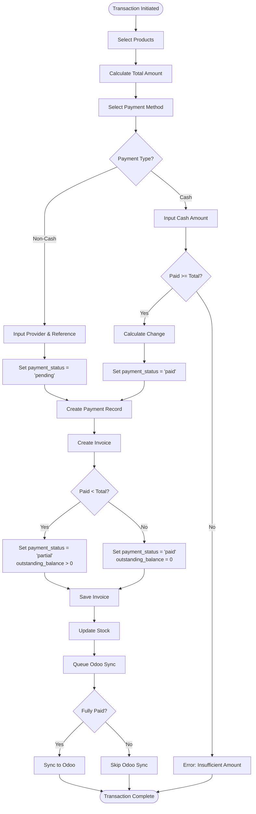

---

## 6. Outstanding Payment Flow

```mermaid
sequenceDiagram
    participant Cashier
    participant Frontend as OutstandingPaymentView.vue
    participant API as Backend API
    participant PaymentService as PaymentService
    participant InvoiceRepo as InvoiceRepository
    participant DB as MariaDB
    participant OdooSync as OdooSyncService

    Cashier->>Frontend: Open Outstanding Payments
    Frontend->>API: GET /api/v1/outstanding-payments
    API->>InvoiceRepo: Find invoices with outstanding_balance > 0
    InvoiceRepo-->>API: List of invoices
    API-->>Frontend: JSON response
    Frontend->>Cashier: Display outstanding invoices

    Cashier->>Frontend: Select invoice to pay
    Cashier->>Frontend: Input payment amount
    Frontend->>API: POST /api/v1/payments
    API->>PaymentService: addPayment(data)

    PaymentService->>DB: BEGIN TRANSACTION
    PaymentService->>DB: Create payment record
    PaymentService->>DB: Update invoice.paid_amount
    PaymentService->>DB: Recalculate outstanding_balance

    PaymentService->>CheckFullyPaid{Fully Paid?}
    CheckFullyPaid -->|Yes| PaymentService->>DB: Set payment_status = 'paid'
    CheckFullyPaid -->|No| PaymentService->>DB: Keep payment_status = 'partial'

    PaymentService->>DB: Create audit_log
    PaymentService->>DB: COMMIT TRANSACTION

    CheckFullyPaid -->|Yes| PaymentService->>OdooSync: queueSync(invoiceId)
    CheckFullyPaid -->|No| SkipSync

    PaymentService-->>API: Return updated invoice
    API-->>Frontend: JSON response
    Frontend->>Cashier: Display updated status

    Note over OdooSync: Async process (non-blocking)
```

---

## 7. Stock Management Flow

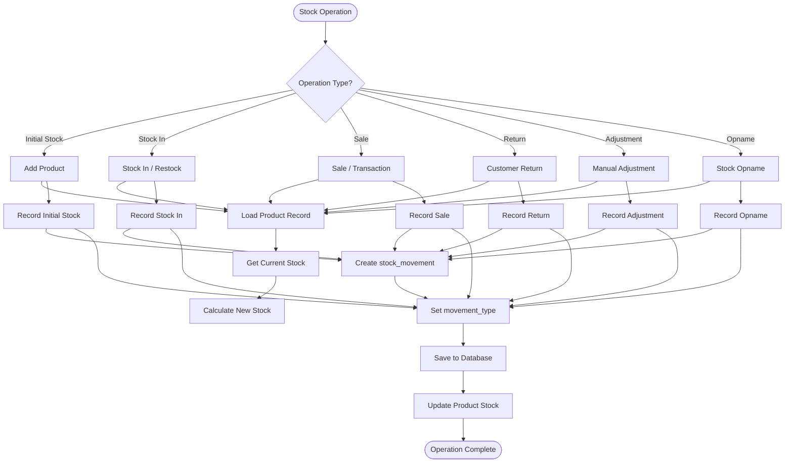

---

## 8. Dashboard Data Flow

```mermaid
flowchart TB
    Start([User Opens Dashboard]) --> Frontend[DashboardView.vue]
    Frontend --> APIRequest[GET /api/v1/dashboard]
    APIRequest --> DashboardService[DashboardService.php]

    DashboardService --> CalculateToday[Calculate Today's Sales]
    DashboardService --> CalculateMonthly[Calculate Monthly Revenue]
    DashboardService --> GetTopProducts[Get Top Selling Products]
    DashboardService --> GetPaymentStats[Get Payment Statistics]
    DashboardService --> GetChartData[Get Chart Data]

    CalculateToday --> QueryToday[Query invoices<br/>WHERE DATE(created_at) = CURDATE()]
    CalculateMonthly --> QueryMonthly[Query invoices<br/>WHERE MONTH(created_at) = CURRENT_MONTH]
    GetTopProducts --> QueryProducts[Query invoice_details<br/>GROUP BY product_id<br/>ORDER BY SUM(quantity)]
    GetPaymentStats --> QueryPayments[Query payments<br/>GROUP BY payment_method]
    GetChartData --> QueryChart[Query invoices<br/>GROUP BY DATE(created_at)]

    QueryToday --> Aggregate[Aggregate Results]
    QueryMonthly --> Aggregate
    QueryProducts --> Aggregate
    QueryPayments --> Aggregate
    QueryChart --> Aggregate

    Aggregate --> BuildResponse[Build Response JSON]
    BuildResponse --> ReturnResponse[Return to Frontend]
    ReturnResponse --> Frontend
    Frontend --> RenderCharts[Render Charts & KPIs]
    RenderCharts --> End([Dashboard Displayed])
```

---

## 9. Report Generation Flow

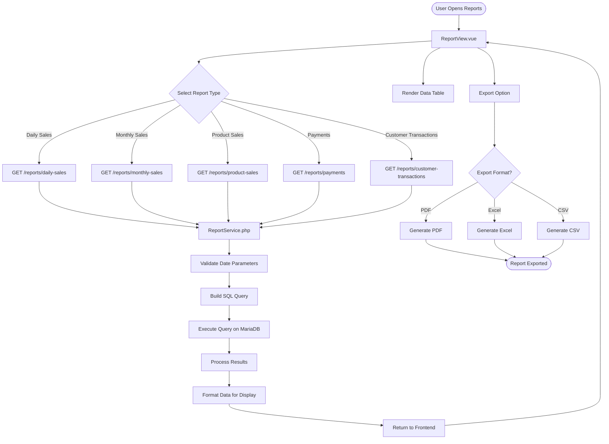

---

## 10. Audit Log Flow

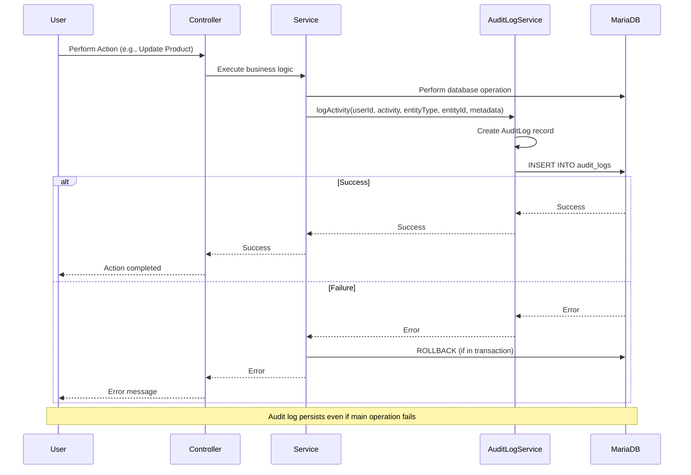

---

## 11. Error Handling Flow

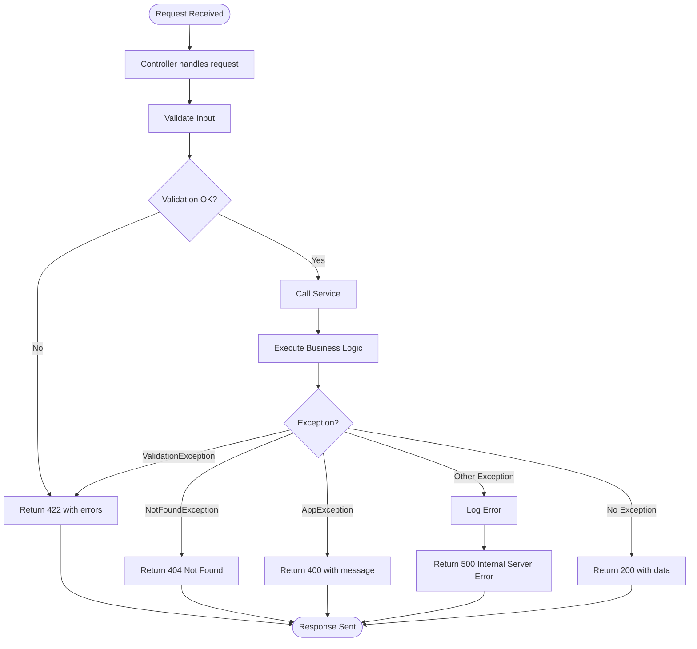

---

## 12. Frontend Router Guard Flow

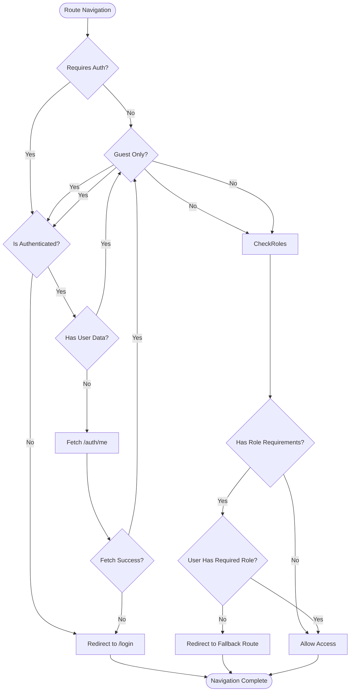

---

## 13. Database Migration Flow

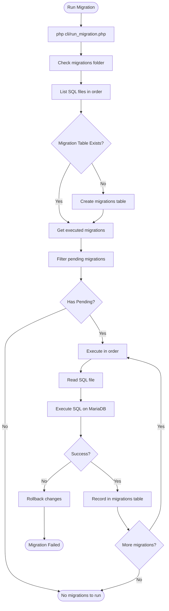

---

## 14. Invoice Generation Flow

```mermaid
flowchart TB
    Start([Transaction Complete]) --> GenerateNumber[Generate Invoice Number]
    GenerateNumber --> FormatNumber[Format: INV-YYYYMMDD-XXXX]
    FormatNumber --> BuildPayload[Build Invoice Payload]

    BuildPayload --> GatherHeader[Gather Header Data]
    BuildPayload --> GatherLines[Gather Line Items]
    BuildPayload --> GatherPayments[Gather Payments]

    GatherHeader --> BuildPayload
    GatherLines --> BuildPayload
    GatherPayments --> BuildPayload

    BuildPayload --> SaveInvoice[Save to Database]
    SaveInvoice --> InvoiceRecord[Invoice Record Created]

    InvoiceRecord --> ReturnToFrontend[Return to Frontend]
    ReturnToFrontend --> RenderHTML[Render HTML Template]
    RenderHTML --> DisplayInvoice[Display Invoice]

    DisplayInvoice --> PrintOption{Print Option?}
    PrintOption -->|Yes| WindowPrint[window.print()]
    PrintOption -->|No| PDFOption{PDF Option?}

    PDFOption -->|Yes| GeneratePDF[Generate PDF via Dompdf]
    PDFOption -->|No| End([Invoice Ready])

    WindowPrint --> End
    GeneratePDF --> DownloadPDF[Download PDF]
    DownloadPDF --> End
```

---

## 15. Multi-Tier Architecture Flow

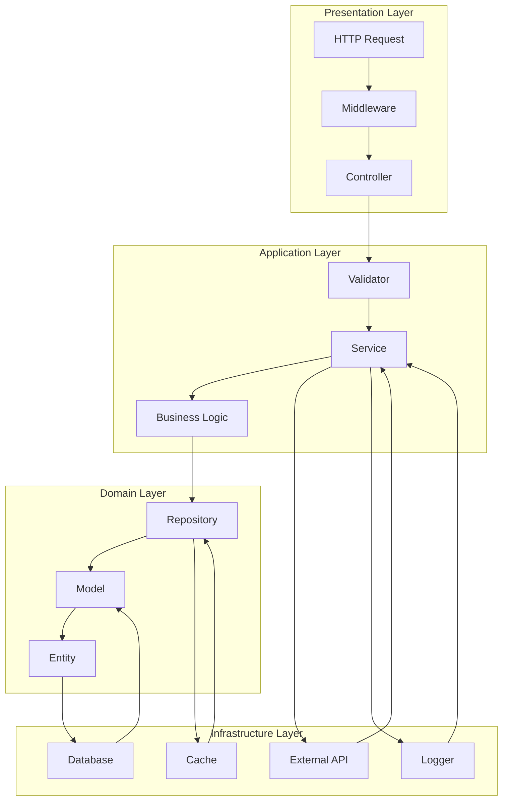

---

## Summary

Dokumen ini berisi 15 flow diagram yang mencakup seluruh aspek aplikasi Zi.CARE POS:

1. **Overall System Flow** - Arsitektur high-level sistem
2. **Authentication Flow** - Proses login dan autentikasi
3. **Transaction Flow** - Proses transaksi penjualan
4. **Odoo Sync Flow** - Sinkronisasi dengan Odoo ERP
5. **Payment Flow** - Proses pembayaran (parsial & outstanding)
6. **Outstanding Payment Flow** - Pembayaran hutang pelanggan
7. **Stock Management Flow** - Manajemen stok dan movement
8. **Dashboard Data Flow** - Pengambilan data dashboard
9. **Report Generation Flow** - Pembuatan laporan
10. **Audit Log Flow** - Pencatatan aktivitas
11. **Error Handling Flow** - Penanganan error
12. **Frontend Router Guard Flow** - Proteksi route berdasarkan role
13. **Database Migration Flow** - Proses migrasi database
14. **Invoice Generation Flow** - Pembuatan invoice
15. **Multi-Tier Architecture Flow** - Arsitektur berlapis

Flow diagram ini membantu memahami alur kerja aplikasi secara visual dan memudahkan developer dalam maintenance dan pengembangan.
